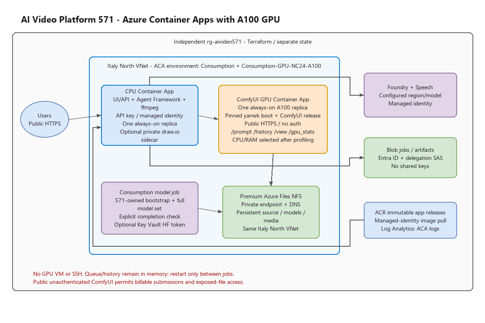

# AI Video Platform on ACA GPU: cinematic and reviewed educational videos

This independent `aivideo571` deployment runs the CPU orchestrator and GPU ComfyUI
as separate Azure Container Apps. ComfyUI uses one always-on A100 replica with
Premium Azure Files NFS storage. The solution does not deploy a GPU VM.
The `555_comfyui_on_aca` folder is a read-only reference, never a deployment dependency.
CPU/RAM sizing and real A100 workflow compatibility require profiling before deployment;
local regression tests are not proof of live GPU compatibility.

## Educational / presentation videos

Select **Educational / presentation** in the web UI or pass `--use-case educational` to the CLI.
This opt-in path does not change cinematic defaults. Educational defaults are horizontal 16:9,
1080p, full narration and intro/outro-only **MiniMax-Music3** music. Choose 4K, vertical 9:16,
music off or full-background music, and deterministic animated presentation scenes,
AI-motion illustrations, or hybrid motion with deterministic technical diagrams. A 4K output canvas does **not**
guarantee native-4K source images; source dimensions and enhancement depend on the configured provider.

Provide a separate, explicit **public-only search topic**. Only `education.public_topic` is sent
to web search, not the private creative prompt or photos. Do not include sensitive information in
the search topic. Educational requests do not accept reference photos or cinematic naturalistic mode.
Planning must obtain real sources; there is no silent ungrounded fallback.

Creation researches the topic and saves a versioned brief/script/storyboard, then pauses at
`awaiting_review`. **No images, video or music are generated before explicit approval.**
Review the URL links in **Research public sources**; edit the title, description, audience, learning objectives,
language locale (for example `en-US`, not bare `en`), theme, scene narration, visual prompts,
animation, roles, citation IDs and diagram graph.
The diagram editor accepts JSON `nodes` (`id`, `label`, `icon_query`) and `edges`
(`source`, `target`, optional `label`), not arbitrary SVG/HTML. This is a storyboard editor,
not a full timeline editor. Research and citations are immutable; regenerate to research again.
Save edits, inspect the resulting revision, then approve that exact revision.
Validation errors (422) and stale revisions (409) are shown; reload after a conflict rather than
approving stale content. Reload/regenerate discards unsaved edits only after confirmation.

Approval freezes content and provider/output choices; content changes after approval require a new job.
The approved narration is preserved in full. Measured narration can extend the requested
15-second–10-minute timeline, but never beyond 10 minutes; an overlong script fails explicitly
instead of being silently rewritten, accelerated or truncated. The **Research public sources**
timeline step displays only a list of clickable source URLs, without source titles, IDs or the
research summary. The latest research step and its run open automatically when URLs are available;
manual collapse choices are preserved. URLs remain available during review and after approval,
including completed or failed renders. Use **Download sources** for source titles and citation IDs.
Sources are also downloadable as
`/api/videos/{id}/education/sources.txt`; rendered PNG/video previews and editable `.drawio`
artifacts appear as operations finish. The UI never injects raw generated SVG.
Educational progress counts completed **scenes**, not individual five-second AI-motion clips;
cinematic progress retains its clip units.

Educational narration explicitly uses Azure Speech **REST over HTTPS**, through the configured
Speech custom endpoint (`/tts/cognitiveservices/v1`), rather than requiring a Speech SDK WebSocket
connection from the application server. Browser clients do not call Speech directly.
The workflow selects `Narrator.synthesize(transport="rest")` and preserves the same approved
SSML, voice and delivery controls. The legacy cinematic workflow keeps its SDK transport default;
there is **no silent fallback** between transports. REST output is 48 kHz mono PCM WAV.
The REST service permits at most 10 minutes of audio per synthesis request (one scene).
After measuring every scene, the timeline adds a combined one-second speech lead/tail allowance,
rounds up to whole frames, and rejects any total above 600 seconds **before images, video or music
are generated**. A REST response truncated at the approximately 600-second service ceiling
therefore fails closed through the timeline limit; it is not accepted as a complete scene.
Create a new job with a shorter script and review it again. The full-video ceiling remains 10 minutes.

### CLI plan, review, edit and approve

Run from `app` using the existing virtual environment. Creation runs locally and does **not**
auto-approve. Review commands use the running API, which must point to the **same storage**
as the creation process (`VIDEO_API_URL` defaults to `http://localhost:8000`; `API_KEY` is read
from the environment / `.env`). Do not put secrets on the command line.

```powershell
python generate.py "Explain how public IP routing works" --use-case educational --public-topic "Public IP routing fundamentals" --minutes 2 --style presentation --audience "New network engineers" --music-mode intro_outro
python generate.py draft JOB_ID --output draft.json
# Edit brief and scenes in draft.json; do not edit the research/source manifest.
python generate.py update JOB_ID --revision 1 --file draft.json
python generate.py draft JOB_ID --output draft.json
# Use the current revision from the saved draft, not the old revision:
python generate.py approve JOB_ID --revision 2
# Alternatively, replace an unapproved draft with a freshly researched plan:
python generate.py regenerate JOB_ID --revision 2
```

Additional creation selectors: `--image-provider comfyui|foundry`,
`--motion-provider comfyui|foundry` (used by `--style ai_motion|hybrid`),
`--text-model <configured-deployment>`, `--music-mode off|intro_outro|background`,
`--resolution 1080p|4k`, `--orientation horizontal|vertical`. Existing cinematic
`--model`, `--music`, reference-photo and naturalistic flags retain their behavior.
Every CLI mutation requires an explicit positive `--revision`; it does not automatically retry
conflicts or approve a newer draft. `draft` prints JSON or writes it using `--output`;
`update` sends only the mutable `brief` and `scenes` plus the explicit revision.

### Hybrid motion for faster educational rendering

Select **Hybrid: one AI clip, then animated illustration** in the web UI, or pass
`--style hybrid` to the CLI (`education.style: "hybrid"` in API requests).
Each non-diagram scene starts with one native-length clip from the selected video model
(about five seconds for Wan 2.2), trimmed if the scene is shorter. The remaining scene
duration uses the approved source illustration with its existing pan/zoom animation,
title and fades. This is a deliberate cut back to the illustration, not a frozen final
AI frame or a loop. Diagrams keep their deterministic presentation/reveal behavior.
Narration, scene order, music placement, output dimensions and measured total duration
remain unchanged. Both ComfyUI and configured Foundry motion providers are supported.

Hybrid generates at most one AI clip per non-diagram scene rather than filling the
entire narration with separately generated clips. It still pays for a full provider
clip when a scene is shorter; savings depend on scene durations and provider speed.
Generated AI clips and presentation tails are persisted for retries. Existing
`presentation` and `ai_motion` behavior and defaults do not change. Create a new job
to choose hybrid; an already-approved job's rendering options remain immutable.

### Educational configuration and capability limits

See `app\.env.sample`: `EDUCATION_TEXT_MODELS` lists additional compatible text deployments;
`EDUCATION_SEARCH_MODEL` selects the supported public-search deployment.
`COMFY_IMAGE_WORKFLOW` points to a compatible text-to-image workflow, separate from photo editing.
It must be ComfyUI API node JSON with input placeholders `{{prompt}}`, `{{width}}`, `{{height}}`,
`{{seed}}` and `{{filename_prefix}}`, and without an `{{image}}` input.
The supplied graph is `app\video_platform\comfy_workflows\qwen_image_t2i.json`, using
Apache-2.0 Qwen-Image FP8 with 20 sampling steps and CFG 4. It requires
`qwen_image_fp8_e4m3fn.safetensors` in ComfyUI's diffusion-model directory and reuses the installed
`qwen_2.5_vl_7b_fp8_scaled.safetensors` text encoder and `qwen_image_vae.safetensors` VAE.
The existing Qwen **Image-Edit** weights are not a substitute for the text-to-image diffusion weights.

The diffusion download is explicitly opt-in in `infra\scripts\03-download-models.sh`.
Set `download_education_images = true` in your local Terraform variables before
running the model-provisioning job through an approved apply.

The Consumption job runs the existing model-download script, with the additional Qwen-Image diffusion download
pinned to a repository revision and SHA-256-checked before publishing it. It does not create
model deployments or cloud resources, and the optional download is not enabled by default.
Set `COMFY_IMAGE_WORKFLOW` to the graph's local path when running outside the container;
the production-container path is `/app/video_platform/comfy_workflows/qwen_image_t2i.json`.
For this graph the renderer rounds dimensions to the required multiple (1080 becomes 1088),
then crops to the exact requested canvas. Backend PNG `.metadata.json` artifacts record verified
source and canvas dimensions; this is not a claim that any arbitrary replacement graph generates
native output at those dimensions, nor that a configured provider has been live-tested.

Optional `FOUNDRY_IMAGE_ENDPOINT` / `FOUNDRY_IMAGE_MODEL` and
`FOUNDRY_VIDEO_ENDPOINT` / `FOUNDRY_VIDEO_MODEL` enable the respective modality adapters
**only when configured for a verified compatible image/video deployment**.
GPT, Claude and Microsoft MAI text families are not interchangeable image/video generators.
No provider fallback, deployment provisioning or billing authorization is implied.

`DRAWIO_MCP_URL` (a private Streamable HTTP `/mcp` endpoint) and `DRAWIO_EXPORT_COMMAND` wire
the self-hosted draw.io MCP and headless exporter; `EDUCATION_FONT` selects a local, licensed,
readable TrueType/OpenType label font. These must actually
be available to the backend runtime for diagrams to work. Technical diagrams use native draw.io
shape searches and deterministic rendering rather than asking an AI video model to spell labels.

For production, use the opt-in orchestrator image with the **native** draw.io exporter.
From the `571_ai_video_platform_aca` directory, build with `app` as the context:

```powershell
docker build --platform linux/amd64 -f app\drawio_runtime\Dockerfile.education -t education-video-platform app
```

This image includes the pinned draw.io desktop runtime, headless display dependencies and a local
font. Its defaults are:

```dotenv
DRAWIO_EXPORT_COMMAND=["python","/app/drawio_runtime/export_native.py"]
COMFY_IMAGE_WORKFLOW=/app/video_platform/comfy_workflows/qwen_image_t2i.json
EDUCATION_FONT=/usr/share/fonts/truetype/dejavu/DejaVuSans.ttf
```

The exporter runs inside the application container: **no Docker daemon or Docker socket is
required in production**. Azure Container Apps cannot use a host-Docker export wrapper.
The MCP remains a **separate, private self-hosted service**; configure its reachable Streamable HTTP
`/mcp` URL in `DRAWIO_MCP_URL`. The optional local service definition is
`app\drawio_runtime\compose.yaml`; its loopback binding is for local use, not a URL reachable from
another production container. Building the orchestrator image does not launch or provision MCP.

### Opt-in Azure Container Apps runtime configuration

The production infrastructure supports a native-export orchestrator image and a private MCP
sidecar in the same Container App. This copied solution is not evidence of a deployed 571
environment. Review the plan and explicitly deploy it before expecting services to be available.

Add the following settings to your existing local `infra\terraform.tfvars` configuration.
The MCP image and digest below are copied from `app\drawio_runtime\compose.yaml`, not an
unpinned catalog tag:

```hcl
educational_runtime = true
education_drawio_image = "jgraph/drawio-mcp:1.0.6@sha256:4ad6be7215bec6d266337fe7037cfdaa250a01db11c9783708b885b395350828"

education_environment = {
  EDUCATION_TEXT_MODELS  = "gpt-6-astra"
  EDUCATION_SEARCH_MODEL = "gpt-6-astra"
  DRAWIO_MCP_URL         = "http://localhost:3001/mcp"
  DRAWIO_EXPORT_COMMAND = "[\"python\",\"/app/drawio_runtime/export_native.py\"]"
  COMFY_IMAGE_WORKFLOW   = "/app/video_platform/comfy_workflows/qwen_image_t2i.json"
  EDUCATION_FONT         = "/usr/share/fonts/truetype/dejavu/DejaVuSans.ttf"
}
```

- `educational_runtime` defaults to `false`. Enabling it builds
  `app\drawio_runtime\Dockerfile.education` with the `app` context and selects the
  content-hash image tag `video-platform:education-${app_hash}`. The existing cinematic default
  tag is also content-addressed (`video-platform:${app_hash}`) when it is disabled.
- `education_drawio_image` defaults to an empty string (no sidecar). With the pinned image set,
  the private MCP sidecar uses 0.5 CPU and 1 GiB memory, port 3001, a health probe and
  `ALLOWED_HOSTS=localhost,127.0.0.1`. It is not exposed through public ingress.
  The main app uses 3.5 CPU and 7 GiB with this sidecar, retaining a total of 4 CPU / 8 GiB
  within the Consumption workload profile limit. Without it, the app retains 4 CPU / 8 GiB.
  External icon-service requests are disabled; native shape lookup stays inside the MCP runtime.
  The orchestrator reaches this **same-app sidecar** through `http://localhost:3001/mcp`;
  this is distinct from a separately deployed container or the standalone local Compose service.
- `education_environment` accepts only the ten documented educational environment variables.
  The example uses the configured text/search deployment and ComfyUI illustration
  workflow. Set optional `FOUNDRY_IMAGE_ENDPOINT` / `FOUNDRY_IMAGE_MODEL` and
  `FOUNDRY_VIDEO_ENDPOINT` / `FOUNDRY_VIDEO_MODEL` only for actual compatible deployments;
  they are not provisioned by this map. Do not put secrets in it; use managed identity.
- The native application image does not need host Docker. MCP runs as the separate private
  sidecar rather than inside the exporter process. Provider access, GPU availability, installed
  Qwen-Image weights and configured ComfyUI connectivity remain prerequisites.

`infra\education.tfvars` provides the non-secret educational settings for this deployment.
Pass `-var-file=education.tfvars` when running Terraform from `infra`, including subsequent
plans, to retain the educational runtime and sidecar. Inspect the plan before applying;
unrelated network/model-download changes are not part of an application-only rollout.

After updating your variables, run `terraform validate` before `terraform plan` from `infra`.
Review changes and costs before an explicitly authorized apply. Setting variables alone does
not deploy resources, install GPU models or verify provider health.

`GET /api/config` exposes configuration flags and configured text deployment names, **not**
live health, verified model compatibility, quota availability or successful provider smoke tests.
Unconfigured illustration/motion providers are disabled in the UI with an explanation.
CLI and API creation share provider preflight validation in `JobManager.create`.
Before approval, storyboards containing technical diagrams also require configured private MCP
and exporter settings; otherwise approval returns a visible 422 validation error.

### Validation and deployment scope

Component validation has exercised real grounded search and structured planning with
`gpt-6-astra`, checksum-verified Qwen-Image weights, a 1920×1088 illustration with Full HD
animation, a 3840×2160 illustration with 4K animation, Wan 2.2 image-to-video at 1280×720
(5.0625 seconds), Speech REST returning a real 48 kHz WAV, and a real instrumental
MiniMax-Music3 cue returned as FLAC (5.990748 seconds). These results apply to those
specific configurations; they do not establish that all configured deployments are compatible.
The REST check used the configured custom endpoint explicitly, not a silent SDK fallback.

Native Docker/draw.io export, private MCP shape lookup, progressive diagram reveals and the
opt-in educational runtime image have also passed live validation. Windows export tests cover
deep render paths beyond MAX_PATH. Presentation animations may contain no source audio;
narration adds an explicit silent bed, preserves its lead-in and uses frame-aligned audio mixing
so music remains audible through padded intro/outro tails.
An approved three-scene Kubernetes presentation has completed end-to-end at 1920x1080,
24 fps and 18.083 seconds, including the exact approved narration, four cited public sources,
native Kubernetes architecture icons, progressive reveals, and audible intro/outro music.
The 15-second requested duration extended to fit narration; authenticated video, source,
image, timing and editable draw.io downloads were verified against that completed job.
The existing Azure deployment has also passed a cloud end-to-end check: a real researched,
edited and approved three-scene presentation completed at 1920x1080, 24 fps and 16.583 seconds,
with five cited sources, native diagrams, narration, audible intro/outro music and authenticated
artifact downloads. The 20 pre-existing jobs were preserved. This result applies to that
deployment and its configured providers, not to unconfigured Foundry image/video models.
The implementation does not automatically provision new paid resources or model deployments.
Paid Foundry submissions do not imply exactly-once billing: synchronous image generation cannot
reattach to a submitted job after an interrupted response; failures are surfaced rather than silently
switching providers or resubmitting paid requests.

You type a prompt and, optionally, attach a photo of a person or a scene. The platform writes a story, turns it into dozens of shots, renders every shot with an open-weight video model on an ACA A100 replica, adds a voice-over and assembles the final video. With a photo, every shot starts from a keyframe redrawn from your photo, so the person or the place stays recognizable for the whole film.



> The diagram source is [images/architecture.drawio](images/architecture.drawio). Open it with [draw.io](https://app.diagrams.net) or the *Draw.io Integration* VS Code extension.

## How it works

Open-weight video models generate **~5 second clips**. A 5-10 minute video is therefore **60-120 clips** that must tell one coherent story. The orchestrator is a [Microsoft Agent Framework](https://learn.microsoft.com/agent-framework/overview/agent-framework-overview) **workflow** (`WorkflowBuilder`) in Python:

| Step | Executor | What it does |
|---|---|---|
| 1 | `EnhancePromptExecutor` | The **prompt-enhancer agent** (gpt-6-astra) turns the idea into a creative brief: title, visual style, setting, tone, and characters with a *fixed* visual description. With a reference photo, the agent **looks at the photo**: the people in it become the main characters (described faithfully, never named or identified) or the place becomes the setting, and `reference_notes` records what the photo shows. |
| 2 | `PlanStoryboardExecutor` | The **story-outliner agent** splits the story into scenes with narration and an exact shot budget (`duration / clip length`). The **shot-writer agents** then write the prompts for each scene in parallel. Each prompt is self-contained (it repeats the character and style descriptions so clips stay consistent) and follows that video model's prompting guide. With a photo, each shot gets two prompts: a **keyframe prompt** (an edit instruction: "keep the woman from image 1 identical, now ... medium shot, golden hour ...") and an **image-to-video prompt** that describes the motion and the camera. |
| 3 | `GenerateKeyframesExecutor` | Only with a photo (otherwise *skipped*). **Qwen-Image-Edit-2511** (4-step Lightning LoRA) redraws the photo into the first frame of every shot, at the video model's resolution in the chosen orientation. All keyframes are rendered before any clip, so ComfyUI loads each model once instead of swapping models for every shot. |
| 4 | `GenerateClipsExecutor` | Sends each shot to ComfyUI through its HTTP API (`/upload/image`, `/prompt`, `/history`, `/view`) and spreads the work over every server in `COMFYUI_URLS`: **text-to-video**, or **image-to-video** from the shot's keyframe. Clips are rendered natively at about 720p, in the chosen [orientation](#orientation-resolution-and-upscaling). Failed clips are retried with a new seed. |
| 5 | `ProcessShotsExecutor` | Brings every shot to the output format: with **SeedVR2** (1080p or 4K only), ComfyUI upscales each shot first, after all the clips so the GPU loads the model once; then ffmpeg scales (lanczos), pads, retimes to 24 fps and adds a stereo track. The generated shots are kept unchanged. See [Orientation, resolution and upscaling](#orientation-resolution-and-upscaling). |
| 6 | `NarrateExecutor` | Azure AI Speech synthesizes each scene's voice-over, in the brief's language, using a multilingual neural voice. The narration is plain spoken text: screenplay-style speaker labels the LLM might add ("Narrator:", "Maya (V.O.):") are stripped so they are never read aloud. |
| 7 | `GenerateMusicExecutor` | Only with `music` (otherwise *skipped*). The **music-director agent** writes one instrumental cue per scene around a shared theme, and **MiniMax Music 3** renders each cue on ComfyUI, sized to the scene's length. See [Background music](#background-music). |
| 8 | `AssembleExecutor` | ffmpeg concatenates each scene's processed shots and mixes in the narration (the LTX-2 / LTX-2.5 audio stays underneath as ambience at 25% volume) and the scene's music. If the narration is longer than the scene, the last frame is held. The scenes are then joined into `final.mp4`. |

This is the default pipeline. The opt-in **naturalistic mode** prepares and measures narration
immediately after the storyboard, before keyframes or clips, and never extends scenes with frozen frames.

The creative steps use LLM agents. The heavy steps are deterministic executors: an LLM tool-calling loop that runs for hours and 120 times would be slow, expensive and fragile. **Each step saves its output** (`input/reference.png`, `brief.json`, `storyboard.json`, `keyframes/shot_NNN.png`, `clips/shot_NNN.mp4`, `upscaled/shot_NNN.mp4`, `processed/shot_NNN.mp4`, `narration/scene_NNN.wav`, `music.json`, `music/scene_NNN.flac`, `scenes/scene_NNN[_voice|_music].mp4`) to Blob Storage. A job interrupted by a restart, deployment or failure resumes where it stopped, without re-rendering finished keyframes, clips, upscaled or processed shots, or music. The `prompt_id` of every keyframe, clip, SeedVR2 upscale and music cue sent to ComfyUI is saved too, so after a restart the orchestrator reattaches to a render that is still running instead of starting it again. Each running job holds a renewable **Blob lease**, so even when Container Apps briefly runs two replicas during a rollout, a job never runs twice.

### Videos from a photo

Open-weight video models only keep a person's likeness *within* one clip. To keep it across 60-120 independent clips, the platform never animates the photo directly: for each shot it first **redraws** the photo into that shot's framing, setting and lighting with Qwen-Image-Edit, then animates that keyframe with the video model's **image-to-video** workflow. Animating the photo itself would make every clip start from the same frame.

- The upload is checked and cleaned before it is stored: PNG, JPEG or WebP only, at most `MAX_IMAGE_MB` (50 MB by default), EXIF orientation applied, **all metadata (EXIF, GPS...) removed**, longest side capped at 2048 px, re-encoded as PNG.
- Each keyframe costs one extra 4-step Qwen-Image-Edit render (roughly 10-20 s on an H100) on top of the clip.
- The prompt is still required: it tells the agents what story to tell around the photo.

> [!IMPORTANT]
> Only upload photos you have the rights to, and of people who agreed to appear in an AI-generated video. The platform doesn't check consent: that responsibility is yours. The agents never try to name or identify the people in a photo.

### Naturalistic mode

Enable **Naturalistic** in the composer, use `--naturalistic` in the CLI, or send
`"naturalistic": true` in the JSON request (also supported inside a multipart request).
It is off by default; existing jobs keep their original behavior.

- **Continuity and direction:** each scene records wardrobe/props, lighting/location, screen
  direction, and starting/ending action state. Shot writers receive neighboring scene context
  while still running in parallel. Prompts favor restrained expressions, plausible contact and
  weight, motivated gestures, static cameras where appropriate, and establishing/action/reaction/detail
  shot variety. Explicitly stylized stories keep their intended genre.
- **Spoken delivery:** short conversational narration, deliberate pauses, optional voice style,
  and literal pronunciation aliases. These are structured controls, not arbitrary SSML.
  Open **Voice and delivery** in the UI to customize them.
- **Measured timing:** synthesize narration before GPU work, reserving 0.4 seconds of lead-in and
  0.6 seconds of tail per scene. If it does not fit, the narrator editor can shorten it twice:
  **at most three syntheses per scene**, including interrupted attempts across job retries.
  Speech is not automatically accelerated, truncated, or placed over a frozen ending.
  Exhaustion fails the job visibly; create a new job with a shorter script or longer scenes.
- **Audio:** consistent narration loudness (ffmpeg loudnorm target -18 LUFS), speech-driven
  ambience ducking, peak limiting with headroom, and short ambience fades at clip boundaries.
  Silent models still receive silence under narration (unless [background music](#background-music) is enabled).
  Visual cuts remain hard cuts. Extra encoding is needed to avoid accumulated AAC timestamp gaps.
- **Duration:** each clip is trimmed down to a whole number of output frames before timing
  narration. A clip shorter than its planned duration fails rather than being padded.
  The requested duration remains an approximate shot budget, not an exact final runtime.

Delivery controls require both naturalistic mode and narration:

| `delivery` field | Default | Allowed values |
|---|---|---|
| `rate_percent` | `0` | Integer from -10 to 10; an explicit artistic choice, never adjusted to fit speech |
| `sentence_pause_ms` | `180` | Integer from 0 to 1000; added between detected sentences/newlines |
| `style` | `null` | A style advertised by the selected voice, or neutral delivery |
| `pronunciations` | `[]` | Up to 20 unique `{"text": "SQL", "alias": "sequel"}` entries; case-sensitive literal substitutions |

The configured Speech endpoint's voice catalog is checked before synthesis for the selected
voice, language (including advertised secondary locales), and style. Standard neural voices
are supported; HD voices are not supported in this mode. Unsupported selections and catalog
lookup failures are explicit job errors, not silent neutral-voice fallbacks. A Speech endpoint
is required when naturalistic narration is enabled; disabling narration still enables visual
direction and ambience finishing.

```json
{
  "prompt": "A quiet documentary about a lighthouse keeper",
  "duration_minutes": 0.5,
  "naturalistic": true,
  "delivery": {
    "rate_percent": -5,
    "sentence_pause_ms": 250,
    "style": null,
    "pronunciations": [{"text": "SQL", "alias": "sequel"}]
  }
}
```

```sh
python generate.py "A quiet documentary about a lighthouse keeper" --minutes 0.5 --naturalistic \
  --voice en-US-AndrewMultilingualNeural --speech-rate -5 --sentence-pause-ms 250 --pronounce SQL=sequel
```

**Recovery:** accepted narration text, measured duration, and audio checksum are journaled
together under content-addressed `narration/natural-v1/` paths. A changed narration source uses
new audio, not a stale WAV. The original plan remains in `storyboard.json`; the accepted version
is saved as `storyboard.narrated.json` and returned by the storyboard endpoint when available.
Naturalistic jobs also record request/render dependency fingerprints. Editing an existing job's
request, visual plan, model settings, or output settings is not supported: incompatible resumes
fail explicitly and require a new job. Legacy jobs cannot be converted in place.

**Limits:** prompting improves direction, not model guarantees. There is no lip sync, new
video model, automatic visual scoring, selective retake UI, or keyframe approval gate in this
release. These remain later features. Automated fixture tests check timing and mixing, not
photorealism or whether narration edits preserve every nuance.

### Background music

Tick **Music (MiniMax-Music3)** in the composer, use `--music` in the CLI, or send `"music": true`. It is off by default, and it works with every video model, with or without a photo, in both the default and the naturalistic mode.

- **Scoring**: once the narration is ready (so every scene's final length is known), the **music-director agent** defines one musical theme for the film (instrument palette, key family, tempo range) and writes one cue per scene in the MiniMax Music 3 caption format: *Global Metadata* (genre, BPM, key, mood arc), *Vocal Details* (always "Instrumental only. No vocals, no singing, no humming, no choir, no spoken words.") and *Arrangement*. The lyrics sent to the model are only section tags (`[Intro]`, `[Instrumental]`, `[Outro]`), so it has no words to sing.
- **Rendering**: [MiniMax Music 3](https://huggingface.co/MiniMaxAI/MiniMax-Music3) renders each cue on ComfyUI ([comfy_workflows/minimax_music3_t2m.json](app/video_platform/comfy_workflows/minimax_music3_t2m.json), translated from the official `audio_minimax_music_3` template) as 32 kHz stereo FLAC, one second longer than the scene. All cues are rendered after all clips, so ComfyUI loads the model once.
- **Mixing**: the cue is trimmed to the exact scene length, faded in and out at the cuts (`MUSIC_FADE_SECONDS`, 1 s by default), played at `MUSIC_VOLUME` (0.3 by default) and **ducked** under the narration and the model's ambience. The video stream is copied, so naturalistic exact durations are kept.

> [!IMPORTANT]
> MiniMax Music 3 uses the [MiniMax-Music3 Community License](https://huggingface.co/MiniMaxAI/MiniMax-Music3/blob/main/LICENSE). Commercial use is free under 20 million USD of yearly revenue (above that, ask MiniMax for a license), and a commercial product or service using it must **prominently display "MiniMax-Music3"** in its user interface: the composer option, the job chips and the timeline step show it. A hosted service must keep safeguards against misuse, and AI-generated content published in a public environment must be disclosed as machine-generated. Unlike MiniMax H3, the license has no territorial restriction.

Music 3 is a song model: the instrumental-only caption and the tag-only lyrics keep it instrumental, but listen to the result before publishing.

### Orientation, resolution and upscaling

Pick them in the composer, with `--orientation`, `--resolution` and `--upscaler` in the CLI, or with the `orientation`, `resolution` and `upscaler` request fields. The defaults (horizontal, 720p, FFmpeg) give the same video as before these options existed.

| Resolution | Horizontal | Vertical (9:16) | Upscaler |
|---|---|---|---|
| `720p` (default) | 1280x720 | 720x1280 | none: the models' native size (`upscaler` is ignored, SeedVR2 is skipped) |
| `1080p` | 1920x1080 | 1080x1920 | `ffmpeg` (default) or `seedvr2` |
| `4k` | 3840x2160 | 2160x3840 | `ffmpeg` (default) or `seedvr2` |

- **Orientation**: the video models always render natively in the chosen orientation (Wan 2.2 and HunyuanVideo 1.5 at 1280x720 or 720x1280, LTX-2 and LTX-2.5 at 1280x704 or 704x1280, since their sizes must be multiples of 64 or 32). The keyframes from a photo use the same size, and the shot-writer agents compose vertical shots for a 9:16 frame (centered subject, medium shots and close-ups, vertical camera moves).
- **Upscaling**: the clips are never rendered above about 720p, so 1080p and 4K cost no extra GPU time to generate. The aspect ratio is always kept: a 1280x704 clip becomes 1920x1056 and is padded to 1920x1080, as it was padded from 704 to 720 before.
  - `ffmpeg`: lanczos scaling. It's fast and runs on the orchestrator, but it adds pixels, not detail.
  - `seedvr2`: [SeedVR2](https://iceclear.github.io/projects/seedvr2/) 7B (ByteDance Seed, Apache 2.0), a one-step diffusion restoration model, upscales every shot on the GPU (x1.5 for 1080p, x3 for 4K) with ComfyUI's native nodes ([comfy_workflows/seedvr2_upscale.json](app/video_platform/comfy_workflows/seedvr2_upscale.json), translated from the official `utility_seedvr2_*_upscale_video` template). It restores real detail, keeps the clip's frames, frame rate and audio, and splits long clips into temporal chunks when they don't fit in VRAM. Measured on the H100 NVL VM for one 5 s clip: about 1.5 min to 1080p and about 10 min to 4K (2160x3840, 121 frames), on top of the clip render itself. 4K with SeedVR2 therefore multiplies the GPU time of a video several times over.
  - SeedVR2 uses the same GPU pool, retries, timeout (`CLIP_TIMEOUT_SECONDS`) and resume as the clips. If it still fails, the job **fails with an explicit error** ("SeedVR2 upscaling of shot N failed: ..."): it never silently falls back to ffmpeg. *Retry* reuses every finished clip and upscale.
- **Naturalistic mode** keeps its exact frame-aligned durations at every resolution, and jobs created before these options keep their naturalistic fingerprints.
- **Storage**: the generated, upscaled and processed shots, the assembled scenes and their narration and music mixes are all kept in Blob Storage, so they can be previewed after the job (or a restart). At 4K this is several times the size of the final video.

The web UI shows these intermediate videos as soon as each one is stored, grouped as *Generated shots → Processed shots → Assembled scenes → Narration and music mixes*, then the final video. A preview that is playing is never reloaded by live updates.

## Video models

| Key | Model | Clip | Audio | License |
|---|---|---|---|---|
| `wan22` (default) | Wan 2.2 14B fp8 + LightX2V 4-step LoRA (T2V and I2V) | 1280x720, 81 frames at 16 fps (5 s) | No | **Apache 2.0**: commercial use allowed |
| `ltx2` | LTX-2 19B distilled, two-stage with x2 latent upscaler (same checkpoint for T2V and I2V) | 1280x704, 121 frames at 24 fps (5 s) | **Yes** (synchronized ambient) | Free under **$10M revenue**, paid license above |
| `ltx25` | LTX-2.5 22B distilled (int8) + Gemma 4 12B text encoder, two-stage with x2 latent upscaler (same transformer for T2V and I2V). Sharper faces and textures, better prompt adherence than LTX-2. Downloaded by `03-download-models.sh`; requires authorized `HF_TOKEN`, see [Enable LTX-2.5](#enable-ltx-25). | 1280x704, 121 frames at 24 fps (5 s) | **Yes** (synchronized ambient) | LTX-2.x Community License: free under **$10M revenue**, paid license above |
| `hunyuan15` | HunyuanVideo 1.5 720p T2V / I2V (+ SigLIP vision encoder), 20 steps | 1280x720, 121 frames at 24 fps (5 s) | No | Tencent Hunyuan Community License: territory **reportedly excludes the EU, UK and South Korea**. Check before using it in France. |

Keyframes for videos made from a photo use **Qwen-Image-Edit-2511** (fp8) with the **4-step Lightning LoRA** (Apache 2.0), whatever the video model. 1080p and 4K videos can be upscaled with **SeedVR2 7B** (fp16, Apache 2.0), see [Orientation, resolution and upscaling](#orientation-resolution-and-upscaling). The *Clip* sizes above are horizontal; vertical videos swap them.

The workflows in [app/video_platform/comfy_workflows](app/video_platform/comfy_workflows) are API-format translations of the official ComfyUI templates (`video_wan2_2_14B_t2v`, `video_wan2_2_14B_i2v`, `video_ltx2_t2v_distilled`, `video_ltx2_i2v_distilled`, `video_ltx2_5_t2v`, `video_ltx2_5_i2v`, `video_hunyuan_video_1.5_720p_t2v`, `video_hunyuan_video_1.5_720p_i2v`, `image_qwen_image_edit_2511`, `audio_minimax_music_3`, `utility_seedvr2_3b_int8_upscale_video`). Values like `"{{prompt}}"`, `"{{seed}}"`, `"{{width}}"`, `"{{image}}"` and `"{{video}}"` are filled at run time with the right JSON type. Input images and videos are uploaded with `/upload/image` to a per-job subfolder (`aivideo/<job id>`) of the ComfyUI server that renders them. To change a workflow, build it in the ComfyUI UI, use **Export (API)**, and put the placeholders back.

### ComfyUI version

[infra/scripts/02-install-comfyui.sh](infra/scripts/02-install-comfyui.sh) pins ComfyUI
to `v0.39.0` and its checked commit. The Consumption provisioning job prepares that source
in NFS storage; the digest-pinned `yanwk/comfyui-boot:cu126-slim` image supplies the CUDA/PyTorch
runtime. Startup trusts only the provisioned ComfyUI Git directory before bootstrap,
because the NFS repository can have different ownership from the runtime user.
It then installs release requirements under the image's PyTorch constraints and
checks CUDA availability. Without that scoped Git trust, `detected dubious ownership`
aborts startup and ACA ingress can return `504: stream timeout` after 240 seconds;
check revision health and startup logs rather than increasing render timeouts.
The provisioning job assigns only the `input`, `output` and `temp` directory owners
to the pinned image's runtime UID/GID `10000:10000`; models and source stay unchanged.
The educational variables enable the checksum-verified Qwen-Image text-to-image
model with `download_education_images = true`.
The boot script directly executes ComfyUI so ACA termination signals
reach it. It deliberately does not follow the image's bundled ComfyUI or a mutable upstream
branch. Changes to the image, ComfyUI release or requirements require compatibility checks.
Every workflow node type is listed in `app/tests/test_units.py`; verify `/object_info` against
the actual deployed runtime before rendering. Upgrade only between jobs.

Educational diagram rendering accepts bundled draw.io stencils, local icon assets,
and the built-in flowchart primitives used by the private MCP service, including its
implicit Process rectangle, Manual Operation trapezoid, and UML Component's bundled
`module` shape. External assets remain
prohibited. Job and operation errors show nested TaskGroup root causes; full grouped
tracebacks remain in server logs, and multiple failures are reported together.

> [!NOTE]
> Rendering performance and CPU/RAM peaks must be measured on the A100 runtime.
> Do not infer sizing from the sample's 2 CPU / 4 GiB or from previous H100 results.
> `comfyui_memory_gib` controls system RAM independently of GPU VRAM. The educational
> variables propose 32 GiB for render validation after a Wan VAE-stage exit-137
> failure at 4 GiB; this is not yet a profiled guarantee for all video models.
> This deployment keeps exactly one replica: ComfyUI queue and history are process-local.
> Older H100 timings elsewhere in this document are historical comparisons, not A100 benchmarks.

### Enable LTX-2.5

All model downloads, including LTX-2.5, are in [infra/scripts/03-download-models.sh](infra/scripts/03-download-models.sh).
The [Lightricks/LTX-2.5](https://huggingface.co/Lightricks/LTX-2.5) repository is gated, so
missing LTX-2.5 weights require an authorized `HF_TOKEN` in the downloader's environment.
The script skips them with a warning (and still exits successfully) if files are missing and no
token is supplied. Terraform runs this script as a Consumption job and does **not** forward your
workstation's `HF_TOKEN`, so a fresh deployment installs every public model and skips LTX-2.5.
Configure the job's Key Vault secret reference to add gated weights. Already-installed
LTX-2.5 files do not require the token on subsequent runs. Never put the token in Terraform
variables, state, source files, or command-line arguments.

1. Sign in to Hugging Face, open [Lightricks/LTX-2.5](https://huggingface.co/Lightricks/LTX-2.5) and accept the license (access is granted right away).
2. Create a **read** token in [Settings > Access Tokens](https://huggingface.co/settings/tokens).
3. Store the token in Azure Key Vault using an approved secret-management method. Grant
   the deployment's app identity access to that secret and ensure the vault is reachable.
4. Set `hf_token_secret_id` to the secret URI (not its value), preferably a versioned URI.
   Review and apply the resulting job/provisioning change between render jobs. The helper
   refuses provisioning when the existing ComfyUI queue is active or cannot be verified.
   Stop new submissions during provisioning; this check cannot prevent unauthenticated
   third parties from adding new work afterwards. Rotating an
   unversioned secret requires explicitly rerunning the job; changing its versioned URI
   automatically schedules provisioning.

The job resolves `HF_TOKEN` through its managed identity. Script contents are delivered from
the checked-out 571 files, not fetched from GitHub. Interrupted downloads resume from `.part`
files; only successful downloads are renamed to the model filenames. Authentication is sent
through curl's standard input, not its command-line arguments, and is not forwarded to a
different host on redirects. Provisioning changes the shared workspace: only run it between
jobs. Successful public provisioning can still report missing LTX-2.5 weights explicitly;
the platform does not fall back to another video model.

## Deploy

Prerequisites: PowerShell 7 (`pwsh`), Azure CLI, Terraform >= 1.14, permissions for the
new resource group, ACR builds and role assignments, A100 quota in Italy North and quota
for the configured Foundry model in its separate region (default `germanywestcentral`).
The default subscription is `Microsoft-Azure-1`; explicitly confirm it before deployment.
GPU quota is environment-specific and may require a request after environment creation.

```powershell
Set-Location infra
.\scripts\initialize-state.ps1
az containerapp env workload-profile list-supported --location italynorth --output table
terraform fmt -check
terraform validate
terraform test  # mocked plan assertions; no Azure resources created
# Create local terraform.tfvars with profiled comfyui_cpu and comfyui_memory_gib.
# No unverified CPU/RAM allocation is supplied by default.
terraform plan -var-file=terraform.tfvars -out=release-571.tfplan
.\scripts\check-plan.ps1 -Plan .\release-571.tfplan
# After separate approval of resources, costs and the inspected new-only plan:
terraform apply .\release-571.tfplan
```

For educational rendering, add `-var-file=education.tfvars` and set
`download_education_images = true`. The initialization helper preserves any inherited
root state in ignored `infra\inherited-state` and reconfigures the backend to
`infra\state-571\terraform.tfstate`, without migrating existing Azure resources.
Never apply the copied `tfplan` or `deploy.tfplan`, import 570 resources, or use the
inherited state. Keep state and backups private: they may contain API keys.
If names are unavailable, use a new unique prefix; do not adopt another deployment.

Before final sizing, obtain approval for any temporary billable profiling deployment.
Exercise all enabled video, image, music and upscale workflows while recording peak
container cgroup CPU/RAM. Select a smaller allocation with measured headroom, verify the
allocation is accepted by the regional profile and rerun the representative workflows.
Record results before approving the final deployment. No live sizing claim is made here.

Terraform creates:

- **VNet** in Italy North: delegated ACA subnet and NFS private-endpoint subnet with
  linked private DNS. ACA and its NFS storage use the same configurable region.

> [!WARNING]
> ComfyUI is public over HTTPS **without authentication**, as requested. Anyone can submit
> billable GPU work, interrupt the queue and access files exposed by ComfyUI. The public
> `/gpu_stats` endpoint reveals GPU and container utilization. The platform API key does
> not protect these separate endpoints. This is not a production-secure exposure model.

- **GPU Container App**: one always-on A100 replica, Single revision, digest-pinned yanwk
  boot runtime, startup/readiness/liveness probes and graceful termination.
- **Premium NFS account/share**: persistent models, source, inputs and outputs, default
  1 TiB capacity. File access uses the private endpoint, not identity-based NFS mounting.
  ACA requires unencrypted NFS transport; this exception does not weaken Blob authentication.
- **Consumption model job**: prepares the checked ComfyUI source and full model inventory.
  Terraform waits for execution success before creating the GPU app. Downloads are
  resumable, provisioning is serialized, and missing gated weights are visibly reported.
- **Microsoft Foundry** resource (`AIServices`, keys disabled), a project, and the **gpt-6-astra** deployment. The same resource provides **Azure AI Speech**; its custom domain is what enables Entra ID auth for TTS.
- **Storage account** (shared keys disabled). Downloads use short-lived *user delegation* SAS URLs.
- **ACR**: immutable content-hash application release, built before managed-identity image
  pull (no local Docker required). The ComfyUI boot image is pulled by its public digest.
- **Container Apps** environment in the VNet, plus the app (1 always-on replica, 4 vCPU / 8 GiB) with a user-assigned managed identity holding `AcrPull`, `Azure AI User`, `Cognitive Services Speech User` and `Storage Blob Data Contributor`.

### Windows ACR build logs

Terraform runs [scripts/build-app-image.ps1](infra/scripts/build-app-image.ps1) to
stream ACR build logs in UTF-8. On Windows, the standard `az.cmd` launcher runs its
bundled Python in isolated mode (`-I`), ignoring `PYTHONUTF8` and `PYTHONIOENCODING`.
The helper invokes that same bundled runtime with `-X utf8` explicitly, preventing
`UnicodeEncodeError` from `cp1252` when build logs contain Unicode.
It still waits for the build and propagates failures; it does not suppress logs.

If a previous Terraform apply failed with this encoding error, inspect the ACR run
status first: a local log-printing failure does not prove the remote build failed.
Then create and review a fresh plan before retrying the apply with the updated helper.
Do not reuse a saved plan containing the old build command.

```sh
terraform output app_url
terraform output -raw api_key
```

Open `app_url` in a browser, paste the API key, describe your video, optionally attach a photo (photo button, drag and drop, or paste), pick the duration, the model, the orientation, the resolution and the upscaler, then click **Generate video** (or press Ctrl+Enter / Cmd+Enter). The large purple-to-blue submit button becomes full-width on mobile and is disabled while the request is being submitted.

The web UI follows the GitHub Copilot app (dark theme). Your videos are listed in a sidebar. Each video opens as a session: your prompt (and photo), then a live timeline of what the agent is doing. The eight pipeline steps expand into their operations:

- each agent call
- each keyframe (with its image once rendered) and each clip, with its ComfyUI server, prompt id, seed, prompt and retries
- each processed shot (and its SeedVR2 upscale, with its ComfyUI server, prompt id and scale)
- each narration
- each ffmpeg and upload step

Each operation has a status and a duration, and shows the warnings logged while it ran. Retries keep the earlier runs, and steps resumed from saved artifacts show as *reused*. Below the timeline, the **Outputs** panel plays every intermediate video as soon as it's stored (generated shots, processed shots, assembled scenes, narration and music mixes), then the final video.

The top bar shows GPU utilization/VRAM and ComfyUI container CPU/RAM, refreshed every
2 seconds. The same HTTPS base URL serves `/gpu_stats`; a small ComfyUI extension samples
off the event loop. CPU/RAM are cgroup usage and limits, not underlying host totals.
Unavailable limits/metrics are reported explicitly, never as a false zero or host-sized
allocation. Leave `GPU_STATS_URLS` empty to hide the badge.

> [!IMPORTANT]
> The A100 replica and allocated CPU/RAM are billed while always on; Premium Files also
> incurs persistent charges. Do not enable ordinary HTTP scale-to-zero: submission
> requests finish before GPU renders. Queue/history are in memory and do not survive
> a restart or revision rollout. Persistent media and Blob checkpoints survive; existing
> retry/resume handles unknown prompts by rerendering. Restart/update only between jobs.

After deployment, verify healthy revisions, CUDA/A100 identity, `/system_stats`,
`/object_info` node coverage, model availability, unauthenticated `/gpu_stats`, authenticated
platform API and real submit/history/download. Run a short cinematic job and an educational
review/approved render; check narration, music, exact output dimensions and stored artifacts.
Then test a controlled between-job restart and verify persistent weights/media and resume.

## REST API

All endpoints require the `X-API-Key` header (or `?key=` for browser links).

```sh
URL=$(terraform -chdir=infra output -raw app_url); KEY=$(terraform -chdir=infra output -raw api_key)

# start a job (202 Accepted)
curl -s -X POST "$URL/api/videos" -H "X-API-Key: $KEY" -H "Content-Type: application/json" \
  -d '{"prompt": "A documentary about a lighthouse keeper'\''s last winter on a remote Breton island", "duration_minutes": 5, "video_model": "wan22"}'

# start a job from a photo of a person or a scene: multipart, same JSON in the 'request' field
curl -s -X POST "$URL/api/videos" -H "X-API-Key: $KEY" \
  -F 'request={"prompt": "Her first trip to Kyoto, told as a travel diary", "duration_minutes": 2}' \
  -F "image=@photo.jpg"

curl -s "$URL/api/videos/<id>" -H "X-API-Key: $KEY"              # status, clips_done/clips_total
curl -s "$URL/api/videos/<id>/storyboard" -H "X-API-Key: $KEY"   # brief, scenes, narration, shot (and keyframe) prompts
curl -s "$URL/api/videos/<id>/operations" -H "X-API-Key: $KEY"   # timeline: steps, agent calls, keyframes, clips, ffmpeg...
curl -sN "$URL/api/videos/<id>/events?key=$KEY"                  # live Server-Sent Events: state, op, end
curl -sL "$URL/api/videos/<id>/download" -H "X-API-Key: $KEY" -o video.mp4
curl -sL "$URL/api/videos/<id>/image" -H "X-API-Key: $KEY" -o photo.png        # the cleaned reference photo
curl -sL "$URL/api/videos/<id>/keyframes/0" -H "X-API-Key: $KEY" -o shot0.png  # keyframe of shot 1 (0-based)
curl -sL "$URL/api/videos/<id>/media/processed/shot_000.mp4" -H "X-API-Key: $KEY" -o shot0.mp4  # an intermediate video
curl -s -X POST "$URL/api/videos/<id>/retry" -H "X-API-Key: $KEY" # resume a failed job
curl -s "$URL/api/gpu" -H "X-API-Key: $KEY"                      # GPU and container stats from GPU_STATS_URLS
```

`/events` first sends the job state and all its operations, then each change as it happens, and `end` once the job is finished. If another replica runs the job, the stream follows it through the artifact store instead (about 2 s behind).

`/media/<name>` serves a job's videos as soon as they exist, with Range requests so a browser can seek: `clips/shot_NNN.mp4` (generated), `upscaled/shot_NNN.mp4` (SeedVR2 output), `processed/shot_NNN.mp4`, `scenes/scene_NNN.mp4`, `scenes/scene_NNN_voice.mp4`, `scenes/scene_NNN_music.mp4` and `final.mp4`. Any other name answers 404. The operations record each file they produce in their `artifact`, `voice_artifact` and `music_artifact` attributes.

`POST /api/videos` accepts either a JSON body or `multipart/form-data` with a `request` field (the same JSON) and an optional `image` file (PNG, JPEG or WebP, up to `MAX_IMAGE_MB`, 50 MB by default; `GET /api/config` returns it as `max_image_mb`). It answers 413 for a photo that is too large, 415 for a file that isn't a supported image, and 422 for an invalid request. `request.reference_image` in the job state is set by the server when a photo was uploaded; clients can't set it.

| Field | Default | Notes |
|---|---|---|
| `prompt` | (required) | Any language. The narration uses the prompt's language. Also required with a photo. |
| `duration_minutes` | `5` | 0.25 to 10. Use 0.25-0.5 for quick tests. |
| `video_model` | `wan22` | `wan22`, `ltx2`, `ltx25` or `hunyuan15` |
| `narration` | `true` | `false` gives a silent video (or LTX-2 / LTX-2.5 audio only) |
| `voice` | `en-US-AndrewMultilingualNeural` | Any Azure neural voice, e.g. `fr-FR-VivienneMultilingualNeural` |
| `seed` | random | Makes clip generation reproducible |
| `naturalistic` | `false` | Opt-in continuity, measured narration before rendering, and improved audio mixing |
| `music` | `false` | Opt-in instrumental background music per scene (MiniMax-Music3), see [Background music](#background-music) |
| `orientation` | `horizontal` | `horizontal` (16:9) or `vertical` (9:16, mobile), see [Orientation, resolution and upscaling](#orientation-resolution-and-upscaling) |
| `resolution` | `720p` | `720p`, `1080p` or `4k` |
| `upscaler` | `ffmpeg` | `ffmpeg` or `seedvr2` (SeedVR2 7B on the GPU). Ignored at 720p: the job state shows `ffmpeg` |
| `delivery` | `null` | Optional structured controls above; requires naturalistic mode and narration |

## Run the orchestrator locally

```sh
cd app
python -m venv .venv && .venv/Scripts/activate        # source .venv/bin/activate on Linux/macOS
pip install -r requirements.txt -r requirements-dev.txt
cp .env.sample .env                                    # fill in values from `terraform output` (COMFYUI_URLS = comfyui_url, GPU_STATS_URLS = gpu_stats_url)
python main.py                                         # http://localhost:8000
# or, without the API:
python generate.py "A short film about a robot learning to paint" --minutes 0.5 --model ltx2
python generate.py "Her first trip to Kyoto" --image photo.jpg --minutes 0.5      # from a photo
python generate.py "A day at the beach" --minutes 0.25 --orientation vertical --resolution 1080p --upscaler seedvr2
```

Locally it uses your `az login` identity (Terraform grants you the same roles as the app). With `STORAGE_ACCOUNT_URL` empty, jobs are written to `./output`. ffmpeg must be on your `PATH`.

## Tests

```sh
cd app
pytest
```

The tests check every ComfyUI workflow graph (text-to-video, image-to-video, keyframe, music and SeedVR2 upscaling: placeholders, links, node types) and the ComfyUI client (image upload, submit, poll, download, retry with a new seed). They also run the **real Agent Framework workflow with real ffmpeg** against a fake ComfyUI, fake LLM agents and fake TTS. That covers the whole pipeline (from a prompt, and from a photo for all four models: the agents get the photo, keyframes come before clips, clips start from their keyframe), the photo checks (formats, size, EXIF orientation and metadata removal), narration longer than a scene, resume without re-rendering keyframes, clips or music, background music (one cue per scene after the clips, instrumental captions and tag-only lyrics, exact scene lengths, fades and ducking), the exact output size of every orientation, resolution and upscaler (measured with ffprobe), SeedVR2 resume, reattachment and explicit failures, reattaching to an in-flight ComfyUI prompt, concurrent retries, jobs locked by another replica, audio/video sync, the operation timeline (live, persisted, across retries and replicas), the REST API (JSON and multipart uploads, intermediate videos with authentication, allowlist and Range requests) with its event stream, the composer controls, and GPU stats (GPU parsing, cgroup container limits, unavailable telemetry, `/api/gpu`). ACA-specific tests also cover the full model inventory, independent state/naming, one-replica configuration and nonblocking telemetry extension.

Naturalistic regression tests cover controls and SSML escaping, language/style validation,
strict continuity output schemas, JSON/multipart/CLI options, early narration, bounded corrections,
checkpoint recovery, checksums, incompatible artifact rejection, output frame counts, decoded
audio peaks, and measured ambience attenuation/recovery. They require both ffmpeg and ffprobe
on `PATH`; skipped media tests are not evidence that the rendering path passed.

For a perceptual A/B evaluation, generate separate legacy and naturalistic jobs with the same
prompt, reference photo (if any), model, voice and seed. Include a person handling a prop, a
walking scene with changes of angle, a quiet interior, and narration in a second supported
language. Have viewers compare continuity, physical motion, voice delivery and editing rhythm,
and record GPU operation durations, synthesis/correction counts and job failures from the
timeline. Repeat across multiple seeds. No live-model quality improvement is claimed solely
from synthetic fixture tests.

## Project layout

```
571_ai_video_platform_aca/
├── app/
│   ├── main.py                     # FastAPI entry point (container CMD)
│   ├── generate.py                 # CLI: one video, no API (--image for a photo)
│   ├── Dockerfile
│   ├── video_platform/
│   │   ├── workflow.py             # Agent Framework workflow (8 executors, each recorded as a timeline step)
│   │   ├── agents.py               # prompt-enhancer (sees the photo), story-outliner, shot-writer agents
│   │   ├── comfyui.py              # ComfyUI API client (image/video upload, T2V/I2V clips, keyframes, SeedVR2 upscaling) + multi-server pool
│   │   ├── gpu.py                  # GPU and container stats from ComfyUI (/api/gpu)
│   │   ├── comfy_workflows/        # API-format workflows: T2V and I2V for the 4 models, Qwen-Image-Edit keyframes, MiniMax Music 3, SeedVR2
│   │   ├── video_models.py         # model registry (resolution, fps, frames, T2V/I2V prompt guides, license) + output resolutions
│   │   ├── images.py               # reference photo checks and cleanup (format, size, EXIF/GPS removal)
│   │   ├── speech.py               # Azure AI Speech TTS (Entra ID)
│   │   ├── media.py                # ffmpeg: normalize (scale, pad, fps), concat, narration and music mix
│   │   ├── storage.py              # Blob / local artifact store
│   │   ├── jobs.py                 # background jobs, resume, retry, live notifications
│   │   ├── operations.py           # operation timeline (steps, agent calls, keyframes, clips...) + log capture
│   │   ├── api.py                  # REST API (JSON or multipart with a photo, intermediate videos) + Server-Sent Events
│   │   └── static/index.html       # web UI (Copilot-style sessions, photo upload, live timeline, outputs panel)
│   └── tests/
├── images/architecture.drawio      # architecture diagram (draw.io, Azure icons) + .png export
└── infra/                          # Terraform, ACA bootstrap and model-provisioning scripts
```

## Going further

- **Character consistency without a photo**: the keyframe + image-to-video path already exists for uploaded photos. Text-only videos could use it too: generate a reference image per character (e.g. Qwen-Image or Z-Image-Turbo, already used in [550_comfyui_on_vm](../550_comfyui_on_vm)) and feed it to `GenerateKeyframesExecutor`.
- **Several photos**: `TextEncodeQwenImageEditPlus` accepts up to three images, e.g. two people and a place.
- **LTX-2.5 multishot**: LTX-2.5 can render several connected shots in one pass, keeping the character, lighting and voice across the cuts. A scene could become one multishot clip instead of independent 5 s shots.
- **Scale out**: add independently addressed GPU apps, each with one stable replica.
  Do not increase replicas behind a shared FQDN until queue/history routing is redesigned.
- **Hosted agent**: the same workflow can be exposed as a Foundry hosted agent with `agent-framework-foundry-hosting`.
